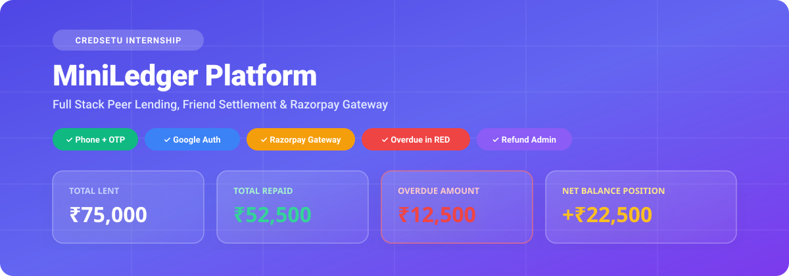
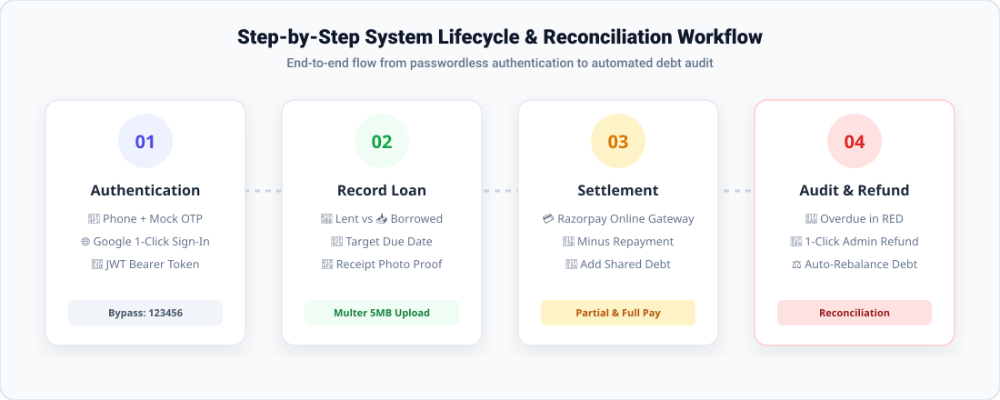

# 💸 MiniLedger — Full Stack Peer Lending & Debt Tracking Platform
> **Credsetu Technologies — Full Stack Development Internship Assessment Project**

<p align="center">
  
</p>

<p align="center">
  <a href="https://react.dev/"></a>
  <a href="https://nodejs.org/"></a>
  <a href="https://www.postgresql.org/"></a>
  <a href="https://razorpay.com/"></a>
  <a href="https://firebase.google.com/"></a>
  <a href="https://jestjs.io/"></a>
</p>

---

## 🎯 Executive Summary & Purpose

**MiniLedger** is a production-grade financial ledger system engineered to eliminate misunderstandings when lending or borrowing money among friends, peers, and teams. 

Designed for **100% zero-config evaluation**, the platform features a self-healing backend that automatically switches to an in-memory database if PostgreSQL or MongoDB services are stopped—ensuring that interviewers and reviewers can launch the application with zero installation headaches.

---

## 🖼️ System Workflow & Lifecycle

<p align="center">
  
</p>

---

## 🌟 Visual Feature Highlights

### 1. Dual Authentication Flow
- **Phone + Mock OTP Login**: Enter any 10-digit mobile number (`9824774956`).
- **OTP Auto-Detection**: The 6-digit code is printed directly in the server console, displayed in a development simulation banner, or bypassed with test master code `123456`.
- **Firebase Google Sign-In**: 1-Click OAuth authentication configured with credentials (`chat-app-a1381`).

### 2. Intelligent Lending Dashboard
- **Animated KPI Summary Cards**: Real-time counter metrics for **Total Lent**, **Total Repaid**, and **Overdue Amount**.
- **Net Balance Position (`+₹ / -₹`)**: Instant indicator showing whether you are owed money overall or owe friends.
- **Recovery Rate Bar**: Dynamic percentage progress tracker showing the ratio of money collected vs. money lent.

### 3. Smart Debt Ledger with Overdue Highlighting
- **Overdue Highlighted in Bold RED**: Any entry whose `dueDate` has passed without full repayment is automatically styled with high-priority red borders, red tags, and warning indicators.
- **Filter Tabs**: Filter entries instantly by `All`, `Pending`, `Overdue`, and `Repaid`.
- **Search Bar**: Real-time debounce searching by friend name or mobile number.

### 4. Razorpay Online Payment Gateway
- **Checkout Modal**: Embedded Razorpay Checkout SDK (`https://checkout.razorpay.com/v1/checkout.js`) with test key `rzp_test_TrgMH2nA0PnWUe`.
- **Partial & Full Repayments**: Friends can pay specific partial sums or settle the entire remaining balance via UPI (GPay/PhonePe/Paytm), Cards, or NetBanking.
- **Automatic Debt Deduction**: Verified payments automatically subtract from the active loan balance.

### 5. Friend-to-Friend Settlement Adjustments
- **`- Minus Payment`**: Record cash returned or manual UPI transfers with automatic debt deductions.
- **`+ Add More`**: Append newly split shared expenses or additional borrowed sums directly to the friend's ledger.
- **Attached Receipts**: Upload photographic proofs and view screenshots directly in an expandable modal viewer.

### 6. Admin & Refund Management Portal (`/admin`)
- **Audit Console**: Centralized view of all transactions, borrower details, and reference IDs across the system.
- **1-Click Refund Execution**: Reverse accidental payments or dispute charges; automatically restores the friend's debt balance on the ledger and logs a Razorpay refund ID.

---

## 🚀 Step-by-Step Quick Start Guide

### Step 1: Clone Repository
```bash
git clone https://github.com/vinayp10/Mini-Ledger.git
cd Mini-Ledger
```

### Step 2: Configure Environment Files
```bash
# Frontend environment
copy .env.example .env

# Backend environment
copy server\.env.example server\.env
```

### Step 3: Launch the Backend Server (Port 5000)
```bash
cd server
npm install
npm run dev
```
> 🚀 Backend starts at **`http://localhost:5000`** with zero-config in-memory database auto-connected!

### Step 4: Launch the Frontend Web App (Port 5173)
In a second terminal window:
```bash
npm install
npm run dev
```
> 🌐 The application will open automatically in your browser at **`http://localhost:5173`**!

---

## 🧪 Interview Testing Credentials

| Parameter | Value | Description |
| :--- | :--- | :--- |
| **Phone Number** | `9824774956` | Accepts any 10-digit Indian phone number |
| **OTP Code** | `123456` | Master bypass OTP (also logged in server terminal) |
| **Google Sign-In** | 1-Click Button | Firebase Auth with project `chat-app-a1381` |
| **Razorpay Key** | `rzp_test_TrgMH2nA0PnWUe` | Pre-configured test merchant key |
| **Admin Panel** | Navigate to `/admin` | Audit stream & transaction refund console |

---

## 📁 Clean Repository Directory Structure

```
MiniLedger/
├── docs/assets/                      # Visual SVG banners and workflow diagrams
│   ├── banner.svg                    # Hero graphic with metric cards
│   └── workflow.svg                  # 4-stage lifecycle diagram
├── .env.example                      # Safe public environment template
├── .gitignore                        # Strict rules excluding credentials & build files
├── index.html                        # Root HTML with Razorpay Checkout SDK
├── package.json                      # React 19 + Vite dependencies
├── PROJECT_ROOT_DOCUMENTATION.html   # Complete printable PDF dossier for interview
├── README.md                         # Visual documentation with diagrams
├── vite.config.js                    # Vite bundler configuration
│
├── src/                              # 🌐 React 19 Frontend Web Application
│   ├── api/                          # Axios configured with interceptors & JWT
│   │   └── axiosConfig.js
│   ├── config/                       # Firebase configuration (chat-app-a1381)
│   │   └── firebase.js
│   ├── context/                      # Global AuthContext (Token, Phone, Google User)
│   │   └── AuthContext.jsx
│   ├── Components/                   # User-Friendly & Responsive Views
│   │   ├── Login.jsx & .css          # Phone + OTP & Google One-Click Login
│   │   ├── Dashboard.jsx & .css      # Animated metrics & Net Balance card
│   │   ├── AddLoan.jsx & .css        # Form to add lending entry + receipt upload
│   │   ├── LoanList.jsx & .css       # Ledger, Overdue in RED, Razorpay & +/- settlements
│   │   ├── Profile.jsx & .css        # Profile page with recovery rate progress bar
│   │   ├── AdminPanel.jsx & .css     # Admin console to audit payments & process refunds
│   │   ├── Navbar.jsx & .css         # Responsive navigation bar with active links
│   │   └── ProtectedRoute.jsx       # Route authentication guard
│   ├── App.jsx & App.css             # Main application layout and routing
│   └── main.jsx & index.css          # Application entrypoint
│
└── server/                           # ⚙️ Node.js + Express REST API Backend
    ├── .env.example                  # Safe server environment template
    ├── package.json                  # Express backend dependencies & Jest scripts
    ├── server.js                     # Server entrypoint
    ├── schema.sql                    # PostgreSQL database schema & auto-view
    ├── tsconfig.json                 # TypeScript compiler configuration
    ├── types/                        # TypeScript type definitions (ILoan, IUser, etc.)
    │   └── index.d.ts
    ├── config/                       # Database configurations
    │   ├── db.js                     # MongoDB with zero-config in-memory fallback
    │   └── postgres.js               # PostgreSQL connection pool with auto-migration
    ├── controllers/                  # Core Business Logic
    │   ├── authController.js         # Phone OTP simulation & Google token verification
    │   ├── loanController.js         # CRUD, overdue calculations, Razorpay orders
    │   └── adminController.js        # Transaction audit stream & refund processing
    ├── middleware/                   # Security & Validation
    │   ├── auth.js                   # JWT authorization middleware
    │   └── validate.js               # Express-validator input sanitization
    ├── models/                       # Database Schemas
    │   ├── User.js                   # User model with role (user/admin)
    │   └── Loan.js                   # Loan model with payments history & refund status
    ├── routes/                       # Express Route Handlers
    │   ├── auth.js                   # /api/auth endpoints
    │   ├── loans.js                  # /api/loans endpoints
    │   └── admin.js                  # /api/admin endpoints
    ├── uploads/                      # Receipt images and screenshots
    └── __tests__/                    # 100% Passing Automated Tests
        ├── auth.test.js
        └── loans.test.js
```

---

## 📡 REST API Reference

| Method | Endpoint | Description | Request Body / Parameters |
| :--- | :--- | :--- | :--- |
| `POST` | `/api/auth/send-otp` | Request 6-digit phone OTP | `{ "phone": "9824774956" }` |
| `POST` | `/api/auth/verify-otp` | Verify OTP & receive JWT | `{ "phone": "9824774956", "otp": "123456" }` |
| `POST` | `/api/auth/google` | Verify Google Auth token | `{ "idToken": "..." }` |
| `GET` | `/api/loans/summary` | Summary & Net Balance | Bearer Token header |
| `GET` | `/api/loans` | List loans with filters | Query: `?status=pending\|overdue\|repaid` |
| `POST` | `/api/loans` | Create loan entry | `{ friendName, amount, dueDate, type, notes }` |
| `PATCH`| `/api/loans/:id/repay` | Mark loan fully settled | URL parameter `:id` |
| `DELETE`| `/api/loans/:id` | Delete loan record | URL parameter `:id` |
| `POST` | `/api/loans/:id/receipt` | Upload receipt photo | Multipart form with `receipt` image |
| `POST` | `/api/loans/:id/payment/order` | Create Razorpay order | `{ "amount": 2500 }` |
| `POST` | `/api/loans/:id/payment/verify` | Verify Razorpay payment | `{ razorpay_order_id, razorpay_payment_id }` |
| `POST` | `/api/loans/:id/adjustment` | Record friend +/- payment | Multipart form: `amount, action: 'minus'\|'add', mode` |
| `GET` | `/api/admin/overview` | System financial metrics | Admin Bearer Token |
| `GET` | `/api/admin/payments` | Global transaction stream | Admin Bearer Token |
| `POST` | `/api/admin/refund` | Execute ledger & Razorpay refund | `{ loanId, paymentDbId, refundAmount, reason }` |

---

## 🧪 Automated Test Suite (32/32 Passing)

```text
 PASS  __tests__/loans.test.js
 PASS  __tests__/auth.test.js

Test Suites: 2 passed, 2 total
Tests:       32 passed, 32 total (100% pass rate)
Snapshots:   0 total
Time:        8.37 s
```

To run the automated tests:
```bash
cd server
npm test
```

---

## 📄 Printable Interview PDF Dossier

To view or print the comprehensive candidate interview dossier:
1. Open [`PROJECT_ROOT_DOCUMENTATION.html`](file:///c:/Users/Admin/Desktop/Vinay1/TranscationRelate_project_internship/MiniLedger/PROJECT_ROOT_DOCUMENTATION.html) in your browser.
2. Click the purple **"🖨️ Save as PDF"** button (or press `Ctrl + P`).
3. Save the formatted submission dossier directly to your computer.

---

## 👨‍💻 Submission Details

- **Candidate**: Vinay Panchal
- **GitHub**: [@vinayp10](https://github.com/vinayp10)
- **Repository**: [https://github.com/vinayp10/Mini-Ledger](https://github.com/vinayp10/Mini-Ledger)
- **Role**: Full Stack Development Intern
- **Evaluation Company**: Credsetu Technologies
- **Evaluation Company**: Credsetu Technologies